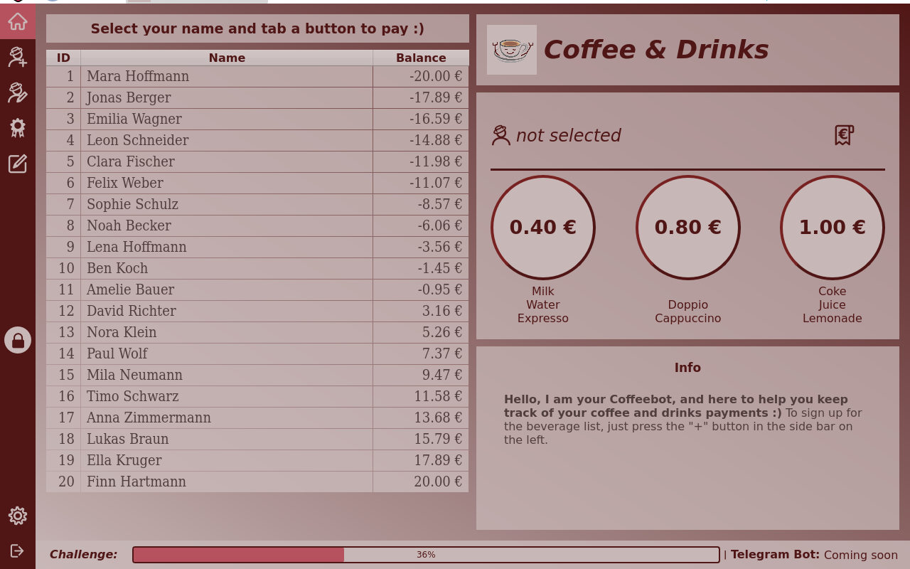

<h1> CoffeeBot</h1>

[](https://github.com/mavinum/CoffeeBot/actions)
[](https://pypi.org/project/coffeebot/)

[](https://github.com/mavinum/CoffeeBot/blob/master/LICENSE)
[](https://github.com/mavinum/CoffeeBot)
[](https://www.raspberrypi.com/software/)

CoffeeBot is a lightweight open source coffee and beverage billing companion for shared spaces.<br>
It helps teams track purchases, manage users and bring the classic "tick list" to the digital age. All you need is a RaspberryPi with touchscreen.

What started as a small project for our groups coffee machine at university ended in this (maybe a bit over-engineered) coffeebot app. If you also think your groups kitchen at work deserves something better than a loose sheet with some names and ticks, feel free to try coffeebot!

If you encounter a bug or have an idea for an improvement, please report it in the GitHub Issues section. CoffeeBot is primarily intended for private or community use and has not been certified as compliant with any particular data-protection or other legal requirements. Operators are responsible for assessing their obligations and protecting any personal data they process. See the [operator data privacy guide](doc/OPERATORS_DATA_PRIVACY.md).

## Features
- **User management** – create, edit, and remove users
- **Flexible pricing** – configure per‑category rates or custom price tables
- **Statistics & reports** – view daily, weekly, and monthly spend summaries; export to CSV, Excel
- **WebDAV backups** – automatic remote backups keep your data safe
- **Modern and intuitive GUI** – built with PyQt6 for Linux
- **Telegram integration** – coming soon; Telegram connectivity is not available in this release
- **Small footprint** – intended for use on a Raspberry Pi with touchscreen



## Download / Install
Use uv to install on your system (recommended):

`uv tool install coffeebot`

After installation, start the app via the `coffeebot` entry point.

If you don't have uv installed yet, see the [installation guide](https://docs.astral.sh/uv/getting-started/installation/).

Alternatively, you can also clone this repository and run coffeebot manually:

```bash
git clone https://github.com/mavinum/CoffeeBot.git
cd CoffeeBot
uv sync
uv run coffeebot
```
Instead of the `uv run coffeebot` command, you can also simply use the provided `coffeebot` entry point.

### Command-line entry points

The following entry points are available when CoffeeBot is installed with `uv tool install coffeebot`:

- `coffeebot` — start the CoffeeBot application.
- `coffeebot-launch` — restart the CoffeeBot systemd service if it is active or enabled; otherwise, launch the application.
- `coffeebot-shortcut` — create a CoffeeBot desktop shortcut.
- `coffeebot-migrate` — copy an existing database and/or settings file into the locations configured for CoffeeBot. Pass `--db` and/or `--config`, for example:

  ```bash
  coffeebot-migrate --db /path/to/user_data.db --config /path/to/config.json
  ```

## Documentation
- [Operator guide: data privacy](https://github.com/mavinum/CoffeeBot/blob/master/doc/OPERATORS_DATA_PRIVACY.md)

## Source Code
The project is open source on GitHub:
https://github.com/mavinum/CoffeeBot

## Issue Tracker
Please report bugs or feature requests via the GitHub Issues page:
https://github.com/mavinum/CoffeeBot/issues

## License
This project is licensed under the GNU General Public License version 3.0 only.
See the [LICENSE](https://github.com/mavinum/CoffeeBot/blob/master/LICENSE).

## Third-Party Notices
This project uses third-party software and libraries. See the [third-party notices](https://github.com/mavinum/CoffeeBot/blob/master/doc/THIRD_PARTY_NOTICES.md).

## Disclaimer
This program is free software: you can redistribute it and/or modify
it under the terms of the GNU General Public License as published by
the Free Software Foundation, version 3 only.

This program is distributed in the hope that it will be useful,
but WITHOUT ANY WARRANTY; without even the implied warranty of
MERCHANTABILITY or FITNESS FOR A PARTICULAR PURPOSE. See the [GNU General Public License v3.0](https://github.com/mavinum/CoffeeBot/blob/master/LICENSE) for the full license terms.

## Copyright
Copyright (c) 2026 Mavinum

## Contact
For other questions, email [Mavinum](mailto:mavinum@tutanota.de).
